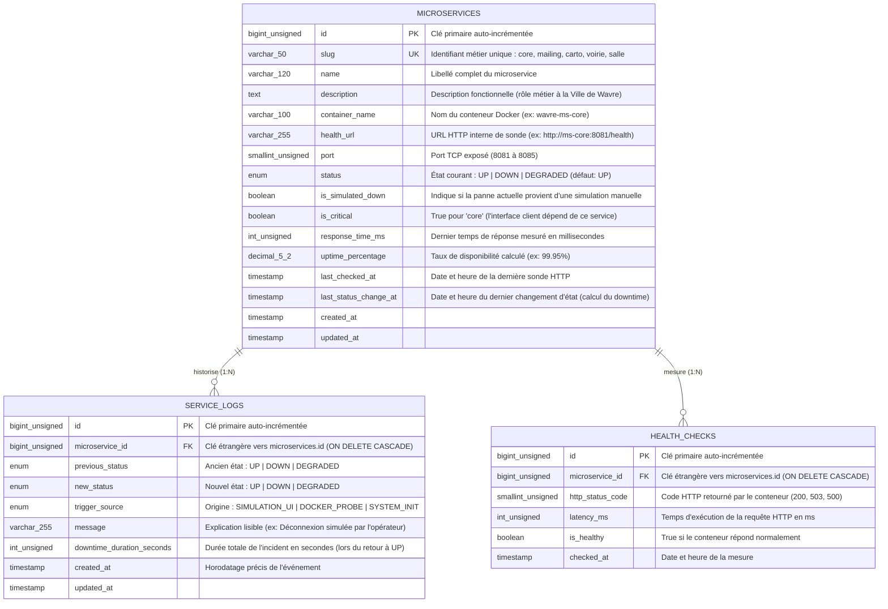

# Schéma Relationnel de la Base de Données — Monitoring Microservices (Ville de Wavre)

Ce document présente l'architecture de la base de données relationnelle (**MySQL 8.0 / MariaDB / SQLite**) utilisée par le backend **Laravel** pour superviser les 5 microservices conteneurisés de la Ville de Wavre (`core`, `mailing`, `carto`, `voirie`, `salle`).

---

## 1. Diagramme Entité-Association (ERD)

---

## 2. Justification des Choix de Modélisation (Pour l'Examen Oral)

### 2.1 Normalisation (3ème Forme Normale - 3NF)
1. **Table `microservices` (État courant & Configuration)** :
   - Stocke l'état instantané (`status`, `response_time_ms`, `last_status_change_at`) des 5 microservices (`core`, `mailing`, `carto`, `voirie`, `salle`).
   - Lire les 5 lignes de la table `microservices` est une opération en $O(1)$ ultra-rapide (< 1 ms) sans avoir besoin de faire un `GROUP BY` coûteux sur des millions de lignes d'historique.
2. **Table `service_logs` (Journal d'Audit & Incidents — Relation `1:N`)** :
   - Enregistre uniquement les **transitions d'état** (`UP -> DOWN`, `DOWN -> UP`, `UP -> DEGRADED`) et calcule exactement combien de secondes un service est resté hors-ligne (`downtime_duration_seconds`) au moment où il se reconnecte.
3. **Table `health_checks` (Télémétrie & Sondes HTTP — Relation `1:N`)** :
   - Sépare les mesures périodiques de latence (`health_checks`) et les incidents/changements d'état (`service_logs`) afin de ne pas polluer le journal d'incidents avec de simples pings `200 OK`.

### 2.2 Intégrité Référentielle & Indexation
- **Clés étrangères (`FOREIGN KEY`)** avec contrainte `ON DELETE CASCADE`.
- **Index d'unicité (`UNIQUE`)** sur `microservices.slug`.
- **Index composite** sur `service_logs(microservice_id, created_at)`.